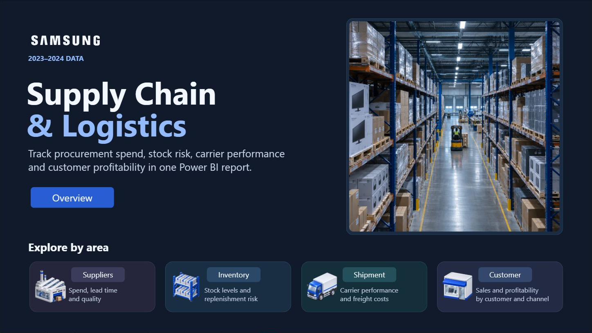
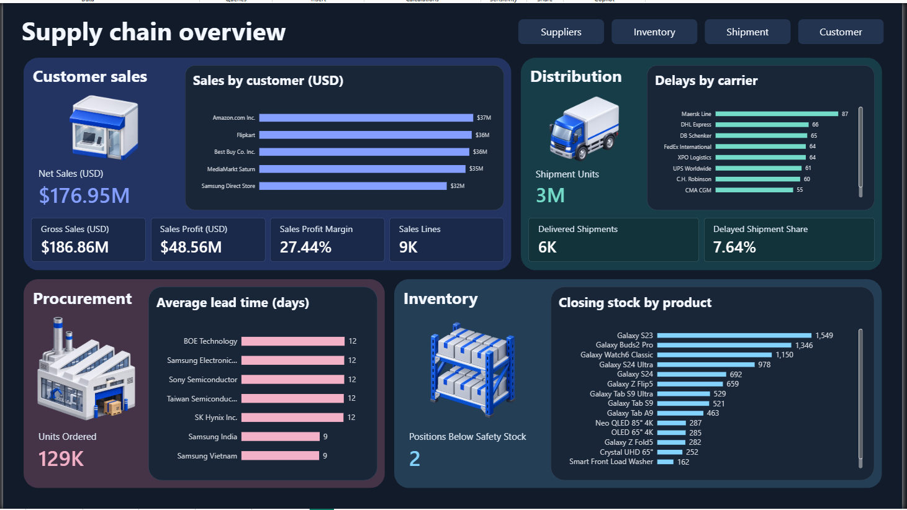
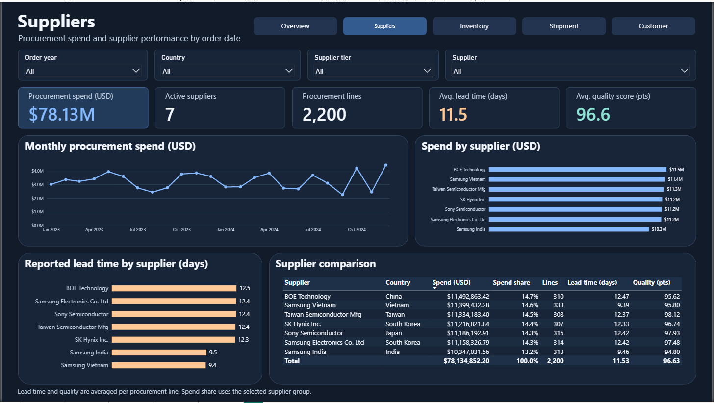
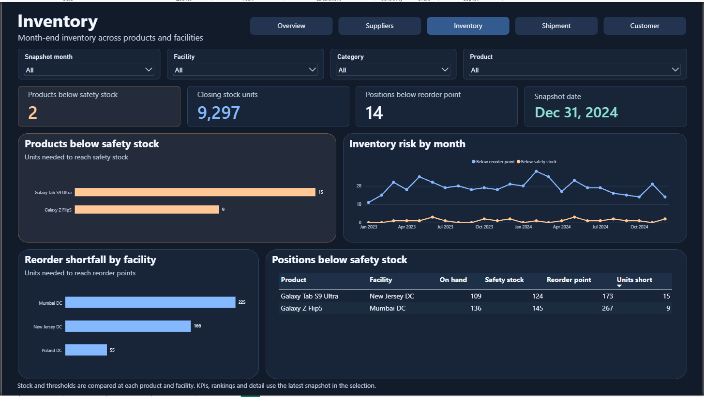
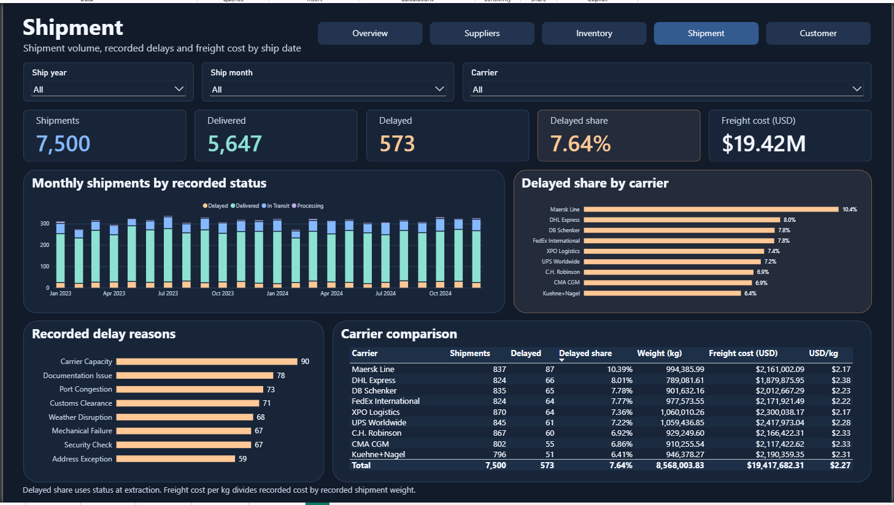
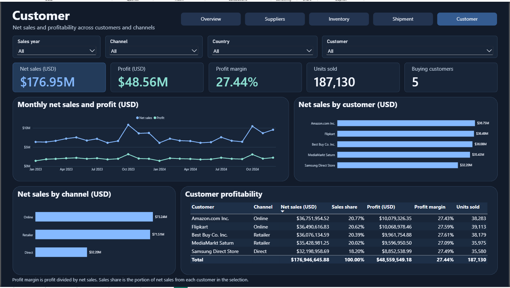

# Samsung Supply Chain Dashboard

Projeto independente de portfólio em Power BI para analisar compras, estoque, produção, vendas e remessas. O relatório usa uma base pública de 2023 a 2024 criada para treinamento e reúne uma visão geral da cadeia de suprimentos e páginas de detalhe para comparar fornecedores, identificar riscos de estoque, acompanhar transportadoras e analisar a rentabilidade por cliente e canal.

**6 páginas no relatório · 5 dimensões · 5 tabelas fato · 40 medidas DAX**

O projeto partiu de arquivos CSV e tabelas de negócio já existentes. O trabalho concentrou-se em estruturar os relacionamentos do modelo semântico, definir e validar indicadores DAX e organizar as análises no relatório. Uma das decisões foi preservar todas as remessas na análise logística e restringir os recortes às informações sustentadas pela base.

[Relatório e capturas](#relatório-e-capturas) · [Modelo dimensional](#modelo-dimensional) · [Decisões e validação](#decisões-e-validação) · [Medidas DAX](#medidas-dax) · [Como abrir](#como-abrir-o-projeto)

## Relatório e capturas

O relatório usa rótulos em inglês e tema escuro. Uma versão clara está disponível na pasta de temas.

[Home](#home) · [Overview](#overview) · [Suppliers](#suppliers) · [Inventory](#inventory) · [Shipment](#shipment) · [Customer](#customer)

### Home

Página de entrada com acesso à visão geral e atalhos para fornecedores, estoque, remessas e clientes.

### Overview

Visão executiva de compras, estoque, distribuição e vendas. Combina cartões de indicadores com comparações de prazo médio por fornecedor, estoque de fechamento por produto, remessas com status `Delayed` por transportadora e vendas líquidas por cliente.

### Suppliers

Compara fornecedores por gasto, prazo médio reportado e qualidade média por linha de compra. Mostra a evolução mensal dos gastos e permite filtrar por ano, fornecedor, país e nível de fornecedor.

### Inventory

Acompanha o estoque no fechamento mensal, as posições abaixo do estoque de segurança ou do ponto de reposição e o déficit em unidades. Inclui histórico mensal, rankings de déficit e uma tabela por produto e instalação.

### Shipment

Acompanha volume, status e custo de frete pela data de envio. Compara transportadoras pelo volume de remessas, pela proporção com status `Delayed` e pelo custo por quilograma. Também apresenta os motivos registrados para `Delayed`.

### Customer

Analisa vendas líquidas, lucro, margem e participação nas vendas por cliente e canal. Mostra a evolução mensal de vendas e lucro, com filtros de ano, país, cliente e canal.

## Modelo dimensional

As cinco dimensões e as cinco fatos já faziam parte da base inicial e foram reaproveitadas. A estrutura foi completada com **15 relacionamentos de negócio**, sendo **13 ativos e 2 inativos**, além da tabela calculada `# Measures`, criada para centralizar os indicadores. `dim_date` foi configurada como calendário do modelo, com uma linha por dia e `Month Start` para as séries mensais.

### Dimensões

| Tabela | Granularidade e papel no modelo | Linhas |
| --- | --- | ---: |
| `dim_date` | Um dia. Calendário de 1º de janeiro de 2023 a 31 de dezembro de 2024, compartilhado pelos cinco processos. | 731 |
| `dim_product` | Um produto (SKU). Contexto de categoria, linha, especificação e peso de catálogo para vendas, compras, produção e estoque. | 16 |
| `dim_customer` | Um cliente. Contexto de nome, país e canal para as vendas. | 5 |
| `dim_facility` | Uma instalação. Contexto de localização e tipo de instalação para estoque e produção. | 6 |
| `dim_supplier` | Um fornecedor. Contexto de nome, localização, especialidade e nível para compras. | 7 |

### Tabelas fato

| Tabela | O que uma linha representa | Dimensões com relacionamento ativo | Linhas |
| --- | --- | --- | ---: |
| `fact_inventory` | Uma posição de estoque por SKU e instalação no fechamento mensal, com saldo e limites de segurança e reposição. | Data do snapshot, produto, instalação | 1.152 |
| `fact_procurement` | Um registro de compra, com quantidade, custo, prazo reportado e pontuação de qualidade. Um número de pedido pode aparecer em mais de uma linha. | Data do pedido, produto, fornecedor | 2.200 |
| `fact_production` | Um registro de produção por produto, instalação e data, com unidades produzidas e defeituosas. A referência de lote permanece na fato. | Data de produção, produto, instalação | 4.500 |
| `fact_sales` | Um registro de venda, com quantidade, valores, descontos, custo e lucro. Um número de pedido pode aparecer em mais de uma linha. | Data da venda, produto, cliente | 8.500 |
| `fact_shipment` | Um registro de remessa, com transportadora, status, quantidade, peso e custo de frete. | Data de envio | 7.500 |

### Práticas aplicadas

- **Esquema em estrela e dimensões compartilhadas.** As dimensões filtram as fatos por relações `1:*`, com direção única da dimensão para a fato. Calendário, produto e instalação são reutilizados nos processos em que suas chaves são compatíveis. Isso permite comparar medidas no mesmo recorte sem juntar diretamente fatos de granularidades diferentes.
- **Granularidade definida antes da agregação.** Estoque, compras, produção, vendas e remessas mantêm seus níveis de detalhe. Números de pedido, lote e rastreamento ficam na fato para consulta. `Sales Lines` e `Procurement Lines` contam registros da fonte.
- **Um calendário com múltiplos papéis.** Compras usam a data do pedido e remessas usam a data de envio por padrão. As duas relações por data de entrega registrada ficam inativas e são ativadas com `USERELATIONSHIP` apenas nas medidas que usam esse recorte.
- **Agregação adequada a cada indicador.** O saldo de estoque é semiaditivo no tempo. As medidas de fechamento usam o último snapshot disponível no recorte e somam posições daquele snapshot. Margens, taxas e custos unitários são recalculados por `DIVIDE` a partir dos totais do contexto.
- **Camada semântica orientada ao relatório.** A importação no Power Query (M) promove cabeçalhos e tipa os campos. O modelo preserva os prefixos `dim_` e `fact_`, oculta chaves e campos de cálculo em várias tabelas e concentra as medidas explícitas em `# Measures`, com descrições, pastas e formatação por unidade.

## Decisões e validação

| Decisão | Evidência e efeito no relatório |
| --- | --- |
| **Restringir os recortes de remessas** | Das 7.500 remessas, 7.500 tinham código de instalação sem correspondência, 5.295 tinham ID de cliente sem correspondência e 4.142 tinham ID de produto sem correspondência. A análise usa data de envio, transportadora e status registrado. As medidas retornam em branco sob filtros diretos das dimensões de produto, cliente, instalação ou fornecedor, evitando exibir o total geral como se pertencesse à seleção. |
| **Interpretar `Delayed` como status do extrato** | A data de entrega registrada também aparece em linhas `In Transit` e `Processing`. Há 148 remessas com essa data no último dia do calendário. O indicador mede a proporção no status `Delayed` entre as remessas do recorte. OTD (*On-Time Delivery*), OTIF (*On-Time In Full*) e dias de atraso ficaram fora do escopo, pois exigem datas prometidas e efetivas validadas. |
| **Medir risco de estoque por posição** | Cada combinação de SKU e instalação é comparada com seus próprios limites no fechamento. Uma posição entra na contagem quando o saldo está estritamente abaixo do limite. Os déficits somam as faltas de cada posição, sem compensação por sobras em outras instalações. |
| **Preservar as unidades de origem** | Compras, vendas e fretes são tratados em USD. O peso por SKU vem do catálogo. O custo de frete por quilograma usa o peso registrado na remessa pela logística. |

### Conferências na base

Foram verificadas a unicidade das chaves das dimensões, a granularidade das fatos e a cobertura das chaves estrangeiras. Todas as chaves dos 15 relacionamentos de negócio encontraram correspondência no CSV da dimensão. As divergências das remessas ocorreram nos campos cadastrais que ficaram fora dos relacionamentos.

| Processo | Referência para conferência nos CSVs |
| --- | --- |
| Estoque, fechamento de dezembro de 2024 | 9.297 unidades em estoque, 2 posições abaixo do estoque de segurança e 14 abaixo do ponto de reposição. |
| Compras, período completo | 2.200 linhas e US$ 78.134.852,20 em gastos de compras. |
| Produção, período completo | 24.102 unidades defeituosas sobre 3.830.447 produzidas, uma taxa observada de 0,63%. |
| Vendas, período completo | US$ 176.946.645,88 de vendas líquidas e US$ 48.559.549,18 de lucro. |
| Remessas, período completo | 573 de 7.500 remessas tinham status `Delayed` (7,64%). A Maersk Line teve a maior contagem e proporção na base, 87 de 837 (10,39%). |

## Medidas DAX

As 40 medidas ficam em `# Measures`, distribuídas nas pastas `Inventory` (9), `Suppliers` (9), `Production` (3), `Customers` (10) e `Deliveries` (9). As medidas de produção estão disponíveis no modelo semântico para análises no Power BI.

Consultar o catálogo das 40 medidas

### Inventory

| Medida | Regra |
| --- | --- |
| `Inventory Snapshot Date` | Data do último snapshot disponível no recorte de estoque. |
| `Closing Stock Units` | Soma das unidades em estoque no último snapshot do recorte. |
| `Closing Safety Stock Units` | Soma dos limites de estoque de segurança no último snapshot do recorte. |
| `Closing Reorder Point Units` | Soma dos pontos de reposição no último snapshot do recorte. |
| `Positions Below Safety Stock` | Contagem de posições de SKU e instalação abaixo do estoque de segurança no último snapshot do recorte. |
| `Positions Below Reorder Point` | Contagem de posições de SKU e instalação abaixo do ponto de reposição no último snapshot do recorte. |
| `Products Below Safety Stock` | Contagem distinta de SKUs com pelo menos uma posição abaixo do limite de segurança no último snapshot da seleção. |
| `Safety Stock Shortfall Units` | Soma das unidades que faltam para atingir o estoque de segurança nas posições deficitárias do último snapshot da seleção. |
| `Reorder Shortfall Units` | Soma das unidades que faltam para atingir o ponto de reposição nas posições deficitárias do último snapshot da seleção. |

### Suppliers

| Medida | Regra |
| --- | --- |
| `Procurement Lines` | Contagem de registros de compra pela data do pedido. |
| `Units Ordered` | Soma das unidades pedidas. |
| `Average Reported Lead Time` | Média simples do prazo reportado, em dias, por linha de compra. |
| `Average Procurement Quality Score` | Média simples da pontuação de qualidade por linha de compra. |
| `Procurement Lines by Recorded Delivery Date` | Contagem de linhas de compra pela data de entrega registrada. |
| `Procurement Spend (USD)` | Soma do custo total das linhas de compra. |
| `Average Purchase Unit Cost (USD)` | Gasto total de compra dividido pelo total de unidades pedidas. |
| `Active Suppliers` | Contagem distinta dos fornecedores identificados com registros de compra no recorte. |
| `Supplier Spend Share` | Gasto do fornecedor no contexto dividido pelo gasto do conjunto de fornecedores selecionado. |

### Production

| Medida | Regra |
| --- | --- |
| `Units Produced` | Soma das unidades produzidas. |
| `Defective Units` | Soma das unidades defeituosas. |
| `Observed Defect Rate` | Total de unidades defeituosas dividido pelo total de unidades produzidas. |

### Customers

| Medida | Regra |
| --- | --- |
| `Sales Lines` | Contagem de registros de venda pela data da venda. |
| `Units Sold` | Soma das unidades vendidas. |
| `Buying Customers` | Contagem distinta dos clientes com registros de venda no recorte. |
| `Gross Sales (USD)` | Soma das vendas brutas registradas. |
| `Sales Discounts (USD)` | Soma dos descontos registrados. |
| `Net Sales (USD)` | Soma das vendas líquidas registradas. |
| `Sales Cost (USD)` | Soma do custo total registrado nas vendas. |
| `Sales Profit (USD)` | Soma do lucro registrado nas vendas. |
| `Sales Profit Margin` | Lucro total dividido pelas vendas líquidas totais. |
| `Customer Net Sales Share` | Vendas líquidas do cliente ou canal divididas pelas vendas líquidas do conjunto selecionado de clientes. |

### Deliveries

| Medida | Regra |
| --- | --- |
| `Shipments` | Contagem de registros de remessa pela data de envio. |
| `Shipment Units` | Soma das unidades registradas nas remessas. |
| `Shipment Weight (kg)` | Soma do peso registrado nas remessas, em quilogramas. |
| `Delivered Shipments` | Contagem de remessas com status `Delivered` pela data de envio. |
| `Delayed Shipments` | Contagem de remessas com status `Delayed` pela data de envio. |
| `Delayed Shipment Share` | Remessas com status `Delayed` divididas pelo total de remessas no recorte. |
| `Delivered Shipments by Recorded Delivery Date` | Contagem de remessas com status `Delivered` pela data de entrega registrada. |
| `Shipping Cost (USD)` | Soma do custo de frete registrado nas remessas. |
| `Shipping Cost per kg (USD)` | Custo total do frete dividido pelo peso total registrado nas remessas. |

## Como abrir o projeto

1. Clone o repositório ou extraia o ZIP. Mantenha as pastas do relatório e do modelo semântico ao lado do arquivo `.pbip`. [Arquivo do projeto](Supply%20Chain%20Dashboard.pbip)
2. Abra o projeto no Power BI Desktop e selecione **Home → Transform data**.
3. No Power Query Editor, selecione **Manage Parameters**, escolha `DatasetFolder` e informe em **Current Value** o caminho completo para a pasta `Dataset` da sua cópia. Por exemplo, `C:\Projetos\SamsungSupplyChain\Dataset`.
4. Selecione **OK** e depois **Close & Apply** para carregar os dados.

As dez consultas usam `DatasetFolder`. Configure esse caminho no primeiro uso de cada cópia e atualize o valor se mover a pasta `Dataset`.

| Pasta | Conteúdo |
| --- | --- |
| [`Supply Chain Dashboard.Report/`](Supply%20Chain%20Dashboard.Report/) | Páginas, visuais, navegação e recursos do relatório. |
| [`Supply Chain Dashboard.SemanticModel/`](Supply%20Chain%20Dashboard.SemanticModel/) | Definições TMDL das tabelas, relacionamentos e medidas DAX. |
| [`Dataset/`](Dataset/) | Dez arquivos CSV usados como fonte. |
| [`Themes/`](Themes/) | Temas claro e escuro em JSON. |
| [`Assets/`](Assets/) | Ícones, recursos gráficos e capturas das páginas. |
